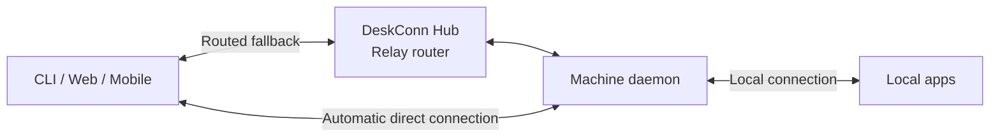

# DeskConn

DeskConn makes your computers accessible from a CLI, web browser, or mobile app.
Open shells, manage files, forward ports, and use remote applications through
one interface, whether your machines are nearby or on another network.

Built on [XConn](https://github.com/xconnio/xconn), DeskConn automatically attempts
a direct peer-to-peer connection to your machine, using the Hub's routed path
while it connects or when a direct connection isn't available. Use the hosted
service, self-host the stack, or run a machine in standalone mode without an
account.

## Capabilities

- **Shells and commands:** open interactive terminals and run remote commands.
- **Files:** browse, upload, download, and edit files on your machines.
- **Networking:** forward ports and connect through VPN exit nodes.
- **Machine tools:** inspect resources and logs, and manage agent sessions.
- **Extensible apps:** connect separate application processes to the local daemon,
  or provide YAML interfaces for existing procedures.

Feature availability varies by operating system; see the
[platform and installation notes](docs/installation.md).

## How it works

The daemon runs on each managed machine and exposes its tools to clients.
Clients automatically attempt a direct connection, with the relay router
providing a routed fallback.



Direct connections currently use WebRTC.

This repository contains the `desk` CLI and machine daemon in one executable,
plus the `appkit` and `relay` packages used by applications and the Hub.
The [Hub](https://github.com/xconnio/deskconn-hub),
[management service](https://github.com/xconnio/deskconn-management),
[web client](https://github.com/xconnio/deskconn-web), and
[mobile client](https://github.com/xconnio/deskconn-mobile) live in separate
repositories.

## Installation

On macOS and Linux:

```sh
curl -fsSL https://get.deskconn.com/install.sh | sh
```

On Windows, use PowerShell:

```powershell
irm https://get.deskconn.com/install.ps1 | iex
```

On Windows, use `deskconn` in place of `desk` in the examples below.

See [installation details](docs/installation.md) for service management, platform
limitations, and configuration paths.

## Getting started

1. Create an account at [web.deskconn.com](https://web.deskconn.com) or in the mobile app.
2. Attach the machine you want to access:

   ```sh
   desk machine attach --username <email>
   ```

3. Log in from the CLI and complete email verification:

   ```sh
   desk account login --username <email>
   ```

4. Find your machines and open a shell:

   ```sh
   desk ls
   desk shell <machine>
   ```

Use `desk top` for an interactive view of your machines, or `desk --help` to
explore the other commands.

## Deployment and apps

- [Standalone mode](docs/standalone.md): serve a machine directly using configured
  users, without an account or the Hub.
- [Self-hosting](docs/self-hosting.md): run the Hub, management service, web app,
  and database with Docker Compose.
- [Adding an app](docs/apps.md): expose local application procedures and build
  manifest-based interfaces.

## Development

Building requires Go, cgo, a C compiler, pkg-config, and the XConn native SDK.
See [native build instructions](docs/native-xconn.md) for platform setup and
custom SDK locations.

```sh
make native-sdk
make build
make test
make lint
```

On Linux and macOS, `make build` produces `bin/deskconn` and `bin/desk`; on Windows,
it produces `bin/deskconn.exe`. See the [self-hosting guide](docs/self-hosting.md)
to build against a local Hub.
